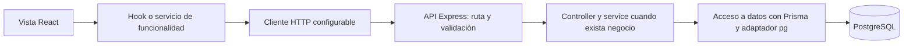

# Arquitectura

Dos aplicaciones privadas en un workspace, un solo lockfile. No se comparten secretos entre ellas.



Autenticación recorre todas las capas hasta User/Session; health no consulta persistencia.
La administración de identidad/rol también recorre esas capas. Contenido, progreso y reportes
conservan su modelo de datos; Student mantiene su demo explícita. Admin muestra dependencias pendientes
cuando no hay servicios disponibles y no fabrica respuestas ni métricas.

## Frontend

La ruta `/` redirige a `/login`. Netlify publica el build Vite de `Frontend/dist`; el archivo
`public/_redirects` sirve index.html para rutas de React sin archivo estático propio.
La sesión sigue comprobándose con el backend antes de acceder a `/student` y sus páginas;
[netlify.md](netlify.md) documenta el build del workspace y las variables públicas.

`src/app/` reúne entrada, router y proveedores. `features/` organiza cada funcionalidad con sus
componentes, hooks, servicios y validaciones cuando sean necesarios. `components/ui/` y
`components/layout/` solo presentan controles y estructuras reutilizables.
`hooks/` contiene estado compartido, `lib/` contiene HTTP/configuración/adaptadores y `styles/`
mantiene tokens globales. `assets/` reúne los recursos locales extraídos para el sistema visual.
Los componentes generales extraídos de Figma están en `components/ui/`, con tokens y estilos por
responsabilidad en `styles/` y fuentes/SVG locales en `assets/`. `ui.html` y `src/dev/` contienen una
galería independiente para desarrollo: no usa router/auth/API y no se incluye en el build de producción.

La UI usa servicios de funcionalidad para contactar la API. `requestJson(path, options)` transmite
AbortSignal, envía cookies con credentials: include y lanza ApiError con `code`, `message` y `status`;
HTTP 204 devuelve undefined.
Las rutas son relativas a VITE_API_URL y se validan antes del fetch. Actualmente no admiten consultas
ni segmentos codificados: ampliar el contrato y sus pruebas cuando una funcionalidad lo requiera.
Los errores de red, cancelación y JSON ilegible tienen códigos estables. Nunca comunicar una
cancelación de navegación como fallo de negocio.

`features/auth/` separa cliente CSRF en memoria, AuthProvider/useAuthSession, guards y formularios.
El proveedor verifica me y representa carga, autenticado, no autenticado y error; no confunde red
con ausencia de sesión. El cliente HTTP notifica 401 UNAUTHENTICATED, sin invalidar por 403.
`/account` conserva su destino de sesión. `/admin` tiene layout protegido, resumen, usuarios/reportes
y perfil/seguridad; creación/edición se presentan en modales y persisten usuarios reales. Perfil reutiliza
el servicio ADMIN para editar la identidad propia. Reportes/evidencia separan presentación y operación
inyectada, sin proporcionar fixtures ni servicios inventados desde las rutas. El guard de rol apoya navegación.
La API vuelve a autorizar cada consulta/escritura. Ver [admin.md](admin.md).

`features/student/` mantiene cinco páginas bajo StudentGuard (solo USER), con el provider y
colección demo existentes. `VITE_STUDENT_DEMO` habilita explícitamente datos educativos también
en un build de producción; sin demo, se informa integración pendiente. Perfil lee la sesión real.
Practicar separa estados visuales, panel, guía y diálogo; no usa cámara ni API de progreso.
Navegación, tema y logout reutilizan el layout existente. Ver [primera fase](phase-one-prototype.md).

`features/auth/login/` presenta Auth de Figma como una ruta independiente del layout técnico.
Reutiliza controles generales con variantes y el mismo hook/proveedor/cliente de autenticación.
La validación local y traducción de errores están separadas de la presentación; véase [login.md](login.md).

## Backend

`app.js` recibe configuración, logger y servicios preparados de auth/usuarios, registra seguridad,
cookies, JSON, health, auth, rutas de usuarios y manejo común de errores;
no lee secretos, abre puertos ni consulta PostgreSQL. `server.js` carga y valida entorno, crea Prisma
cuando hay URL, conecta e inicializa ambos servicios antes de escuchar y maneja SIGINT/SIGTERM.

`Backend/app.js` es la entrada nativa para Vercel: exporta Express, valida entorno e inicializa los servicios,
con conexión Prisma diferida y sin puerto ni listeners de señales. Solo allí, con `VERCEL=1`, se acepta
un salto del proxy de la plataforma para HTTPS/IP. El servidor local mantiene TRUST_PROXY_IPS.
`Backend/vercel.json` fija el preset Express y genera Prisma durante el build;
[vercel.md](vercel.md) documenta despliegue y límites por instancia.

Auth separa rutas, validaciones Zod estrictas, controllers, service y repositorio Prisma.
Controllers traducen HTTP; services ejecutan reglas; repositorios usan Prisma.
Health tiene una sola ruta sin negocio y no necesita crear artificialmente esas cinco capas.

Contrato actual:

```json
{ "data": { "status": "ok", "service": "vocessilentes-api" } }
```

Errores usan `{ "error": { "code": "NOT_FOUND", "message": "Ruta no encontrada" } }`.
Estados generales: 400 INVALID_INPUT, 403 ORIGIN_NOT_ALLOWED, 404 NOT_FOUND, 413 PAYLOAD_TOO_LARGE,
500 INTERNAL_ERROR. Auth añade 401, 403 CSRF/permisos/transporte, 409, 429 y 503; ver
[contratos completos](api.md). Errores internos no exponen trazas, entradas ni mensajes del driver.

CORS valida orígenes exactos con credenciales y Content-Type/X-CSRF-Token; las peticiones sin Origin
siguen permitidas para clientes de servidor, con las demás protecciones.
Helmet agrega cabeceras, JSON tiene límite de 100 KB y Pino registra método, id, estado y duración.
La lista permitida omite URLs, query, headers, cuerpos y mensajes/stack internos.
Auth incorpora requireSession y requireRole con User vigente, CSRF firmado y límites IP/IP+correo.
Toda nueva mutación con cookies necesita CSRF; todo recurso de cuenta debe usar req.auth.id y permisos.
Consultar [seguridad y topología de despliegue](authentication.md).

## Prisma y PostgreSQL

Prisma 7 usa `prisma.config.js` para DIRECT_URL de CLI y migraciones, separada de DATABASE_URL del
runtime. El esquema se divide por dominio en varios archivos Prisma, todos en el namespace privado
`vocessilentes`. Incluye usuarios/identidades/sesiones, contenido, progreso y reportes; el contrato
completo y sus CHECK se describen en [data-model.md](data-model.md).
`prisma-client` genera TypeScript en `generated/prisma/`; esbuild lo compila a
`generated/client.js`, JavaScript ESM. Las aplicaciones escritas por el equipo siguen siendo JavaScript.
No se usa el generador obsoleto prisma-client-js ni opciones experimentales.

`createDatabase()` importa ese cliente solo si hay DATABASE_URL y pasa PrismaPg al constructor.
El adaptador usa pg con espera de conexión limitada y esquema `vocessilentes`. Prisma gestiona su pool y `$disconnect()`
lo libera. En Vercel usa un pool externo pg limitado y attachDatabasePool para liberar conexiones
ociosas al suspender Fluid compute; disposeExternalPool conserva el cierre por `$disconnect()`.
El cierre local drena HTTP antes de desconectar; tiene un límite de 10 segundos en server.js.
Pruebas del cierre verifican orden y desconexión incluso ante error HTTP usando un doble explícito.

Sin URL se permite la base HTTP sin persistencia; health solo es liveness. `db:check` es una
comprobación independiente de PostgreSQL mediante SELECT 1. No confundirla con generación del cliente
ni validación del esquema, que no prueban conectividad.

La migración inicial crea nueve tablas de aplicación, relaciones restrictivas, índices, CHECK,
RLS sin políticas y revoca acceso de roles Data API. No toca auth/storage ni integra Supabase Auth.
Se aplicó mediante migrate deploy en la base de desarrollo confirmada, sin shadow ni datos simulados.
[migrations.md](migrations.md) documenta generación/revisión/aplicación y límites del diff de Prisma.
Las pruebas SQL usan PGlite en memoria; la conexión real y el catálogo remoto se verifican aparte.
Auth usa sesiones opacas y transacciones sobre User/Session sin cambios de esquema. Pendientes:
endpoints de contenido/progreso/reportes, OAuth, correo, recuperación y despliegue de producción.

El [Módulo II, Día 1](module-ii/README.md) añade una décima tabla AuditLog mediante migración
aditiva versionada, probada en memoria y todavía no aplicada a Supabase en esta tarea. El módulo
administrativo incorpora listado paginado real y borrado lógico: conserva advisory lock/bloqueos
de fila y registra cada creación/edición/eliminación ADMIN en su misma transacción. Borrar revoca
las sesiones, conserva relaciones e impide quitar el último ADMIN activo. La bitácora permite
solo lectura paginada ADMIN; no almacena snapshots personales ni credenciales.
