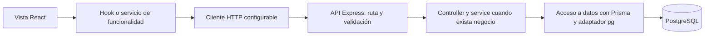

# Arquitectura

Dos aplicaciones privadas en un workspace, un solo lockfile. No se comparten secretos entre ellas.



El tramo de persistencia está preparado; no se usa desde health ni la pantalla inicial.
Los elementos futuros del diagrama no representan módulos ya implementados.

## Frontend

`src/app/` reúne entrada, router y proveedores. `features/` organiza cada funcionalidad con sus
componentes, hooks, servicios y validaciones cuando sean necesarios. `components/ui/` y
`components/layout/` solo presentan controles y estructuras reutilizables.
`hooks/` contiene estado compartido, `lib/` contiene HTTP/configuración/adaptadores y `styles/`
mantiene tokens globales. `assets/` se creará cuando existan recursos locales aprobados.

La UI usa servicios de funcionalidad para contactar la API. `requestJson(path, options)` transmite
AbortSignal y lanza ApiError con `code`, `message` y `status`; HTTP 204 devuelve undefined.
Las rutas son relativas a VITE_API_URL y se validan antes del fetch. Actualmente no admiten consultas
ni segmentos codificados: ampliar el contrato y sus pruebas cuando una funcionalidad lo requiera.
Los errores de red, cancelación y JSON ilegible tienen códigos estables. Nunca comunicar una
cancelación de navegación como fallo de negocio.

## Backend

`app.js` recibe configuración y logger, registra seguridad, JSON, health y manejo común de errores;
no lee secretos, abre puertos ni consulta PostgreSQL. `server.js` carga y valida entorno, crea Prisma
cuando hay URL, conecta antes de escuchar y maneja SIGINT/SIGTERM.

Los módulos futuros separarán rutas, validaciones, controllers, services y acceso a datos según
su complejidad. Controllers traducen HTTP; services ejecutan reglas; repositorios usan Prisma.
Health tiene una sola ruta sin negocio y no necesita crear artificialmente esas cinco capas.

Contrato actual:

```json
{ "data": { "status": "ok", "service": "vocessilentes-api" } }
```

Errores usan `{ "error": { "code": "NOT_FOUND", "message": "Ruta no encontrada" } }`.
Estados: 400 INVALID_INPUT, 403 ORIGIN_NOT_ALLOWED, 404 NOT_FOUND, 413 PAYLOAD_TOO_LARGE,
500 INTERNAL_ERROR. Errores internos no exponen trazas, entradas ni mensajes del driver.

CORS valida orígenes exactos; las peticiones sin Origin siguen permitidas para clientes de servidor.
Helmet agrega cabeceras, JSON tiene límite de 100 KB y Pino registra método, id, estado y duración.
La lista permitida omite URLs, query, headers, cuerpos y mensajes/stack internos.
Esto no implementa permisos: la autorización futura debe validarse en backend.

## Prisma y PostgreSQL

Prisma 7 usa `prisma.config.js` para URL de CLI y migraciones. El esquema solo declara proveedor y
generador. `prisma-client` genera TypeScript en `generated/prisma/`; esbuild lo compila a
`generated/client.js`, JavaScript ESM. Las aplicaciones escritas por el equipo siguen siendo JavaScript.
No se usa el generador obsoleto prisma-client-js ni opciones experimentales.

`createDatabase()` importa ese cliente solo si hay DATABASE_URL y pasa PrismaPg al constructor.
El adaptador usa pg con espera de conexión limitada. Prisma gestiona su pool y `$disconnect()`
lo libera. El cierre drena HTTP antes de desconectar; tiene un límite de 10 segundos en server.js.
Pruebas del cierre verifican orden y desconexión incluso ante error HTTP usando un doble explícito.

Sin URL se permite la base HTTP sin persistencia; health solo es liveness. `db:check` es una
comprobación independiente de PostgreSQL mediante SELECT 1. No confundirla con generación del cliente
ni validación del esquema, que no prueban conectividad.

Pendiente: acordar entidades, integridad, permisos, migraciones y contratos del MVP. No hay datos
simulados ni tablas ficticias. Las migraciones de desarrollo necesitan base dedicada y permisos
para shadow database; no se ejecutan en producción ni automáticamente al arrancar.
