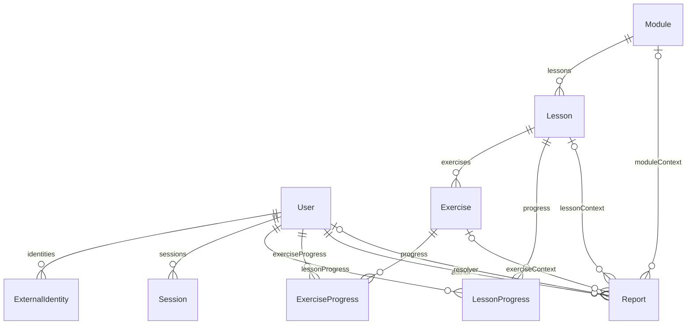

# Modelo de datos — fase 1

Contrato aprobado en la solicitud del 9 de octubre de 2026. PostgreSQL y Prisma **7.10.0**,
con nueve entidades en el esquema privado `vocessilentes`. El esquema se divide por dominio
en `Backend/prisma/{accounts,content,progress,reports}.prisma`; `schema.prisma` conserva el generador.
Los arrays de relaciones de Prisma son campos virtuales: no crean arrays de referencias en PostgreSQL.

La solicitud describe un PDF anterior de MongoDB/Mongoose, pero ese PDF no estaba accesible en los
adjuntos ni en el repositorio. Las decisiones siguientes provienen del texto recibido; no se afirma
haber cotejado directamente el documento. No hay endpoints, pantallas ni autenticación implementados.

## Convenciones comunes

- Todos los `id` son UUID, PK con `gen_random_uuid()` nativo de PostgreSQL; no se necesita extensión.
- Todos los instantes usan `timestamptz(3)`. Enviar ISO 8601 con zona y representar UTC (`Z`) en API.
  PostgreSQL conserva el instante; la zona de sesión solo cambia su representación. `Date` usa UTC.
- `createdAt` tiene default `now()`; `updatedAt` tiene default `now()` y `@updatedAt` de Prisma.
  Este último no es un trigger: SQL manual debe actualizarlo explícitamente. CHECK evita retroceder
  respecto de `createdAt` en User y Report, pero no implementa historial de cambios.
- Las FK usan **ON DELETE RESTRICT / ON UPDATE CASCADE** en todas las relaciones. No hay cascadas
  de borrado ni SET NULL que puedan perder contexto. Una purga física necesita un procedimiento futuro
  explícito de retención y orden de borrado; esta tarea solo prepara eliminación lógica.
- Rutas de multimedia son texto opcional: referencia de objeto o ruta, sin binarios, tokens ni URLs
  firmadas persistidas. Las futuras validaciones deben limitar su origen y generar acceso temporal.
- Nombres, títulos, descripciones e instrucciones obligatorios no admiten espacios como único contenido.

## User, identidades y sesiones

| Campo User                | Contrato                                                                                 |
| ------------------------- | ---------------------------------------------------------------------------------------- |
| `id`                      | UUID, identificador                                                                      |
| `firstName` / `lastName`  | Nombre obligatorio / apellido opcional, varchar(100); apellido presente no vacío         |
| `email`                   | Obligatorio, varchar(254), UNIQUE, ASCII canónico en minúsculas sin espacios periféricos |
| `username`                | Obligatorio, varchar(50), UNIQUE, patrón `[a-z0-9_]{3,50}`                               |
| `passwordHash`            | Obligatorio, varchar(255), hash codificado Argon2id o bcrypt                             |
| `profileImagePath`        | Texto opcional, referencia a foto                                                        |
| `role`                    | `USER` (default) o `ADMIN`                                                               |
| `isActive`                | Default true; permite desactivación administrativa                                       |
| `emailVerified`           | Default false; sin flujo de verificación en esta fase                                    |
| `failedLoginAttempts`     | Entero >= 0, default 0                                                                   |
| `lockedUntil`             | Instante opcional del límite de bloqueo temporal                                         |
| `isDeleted` / `deletedAt` | Default false / null; true requiere fecha >= creación; false exige null                  |
| `createdAt` / `updatedAt` | Instantes de creación y actualización                                                    |

Correo: futuras validaciones hacen `trim().toLowerCase()` sobre ASCII, validan sintaxis completa y
longitud antes de escribir. Username: `trim().toLowerCase()` y patrón anterior. El CHECK de correo
no reemplaza la validación completa de correo: limita el almacenamiento canónico ASCII con `@`.
Los CHECK rechazan variantes con mayúsculas y los UNIQUE rechazan el valor canónico repetido; así
no pueden existir duplicados por diferencias de caja, incluso al escribir directamente con SQL.
No se eliminan puntos, alias `+` ni se aplican reglas particulares de Gmail. Email internacional
requiere acordar IDNA/EAI y una migración futura; no se normaliza Unicode ambiguamente.
Los UNIQUE incluyen cuentas eliminadas: email y username quedan reservados para evitar apropiación
de identidades. Reactivar o anonimizar requiere una decisión de retención posterior.

`isActive`, `lockedUntil` e `isDeleted` son estados independientes; eliminar lógicamente no altera
automáticamente el estado administrativo ni borra sesiones, identidades, reportes o progreso.
La autorización futura comprobará `!isDeleted && isActive` y bloqueo vigente, además de la sesión.
La discrepancia de **5 o 6 intentos** del prototipo queda pendiente junto con duración, recuperación
y actualización atómica del contador. No hay implementación de ninguna regla de bloqueo.

`ExternalIdentity`: `id`, `userId` (FK obligatoria), `provider` (`GOOGLE` o `MICROSOFT`) y
`providerUserId` obligatorio, varchar(255), no vacío. UNIQUE (`provider`, `providerUserId`) y
índice por `userId`. Un usuario tiene 0..N identidades; cada identidad pertenece a un usuario.
El identificador del proveedor es opaco y sensible a caja; no se usa el email como sujeto externo.
No se guardan contraseñas de proveedor ni tokens OAuth. No hay login ni vinculación automática.

El registro local requiere hash de contraseña: no se crean cuentas sin contraseña ni se insertan
hashes inventados para cubrir cuentas externas. Identidades externas solo podrán vincularse a una
cuenta local existente cuando se implemente y autorice ese flujo. Admitir cuentas exclusivamente
externas requerirá **otra migración** y una regla atómica que exija contraseña o identidad verificada;
el contrato actual deliberadamente no las admite.

Nunca escribir contraseñas originales. El SQL exige el prefijo de una codificación Argon2id/bcrypt;
esa comprobación **no valida** un hash criptográfico ni sus parámetros. El servicio futuro debe usar
una biblioteca de hashing, verificar su formato completo y elegir parámetros aprobados (preferencia
Argon2id; bcrypt solo cuando exista necesidad de compatibilidad). No se instaló ninguna biblioteca
de autenticación y los fixtures de prueba no son credenciales utilizables.

`Session`: `id`, `userId` (FK), `tokenHash` UNIQUE char(64), `createdAt`, `expiresAt`, `revokedAt?`.
El hash es SHA-256 hexadecimal en minúsculas de un token aleatorio de alta entropía (al menos 256 bits),
emitido por el futuro backend. No se almacena el token original. SHA-256 es para tokens aleatorios,
no para contraseñas humanas. CHECK exige 64 dígitos hex, expiración > creación y revocación >= creación.
Índices (`userId`, `expiresAt`) y (`expiresAt`) cubren consulta de sesiones del usuario y vencimientos.
Una sesión válida requiere revocación nula, expiración futura y cuenta habilitada; cookies, emisión,
revocación automática y middleware quedan fuera de esta tarea.

## Contenido compartido

| Entidad  | Campos además de `id`                                                                                                        | Relaciones y restricciones                                                                 |
| -------- | ---------------------------------------------------------------------------------------------------------------------------- | ------------------------------------------------------------------------------------------ |
| Module   | `title` varchar(200), `description`, `imagePath?`, `order`, `publicationStatus`                                              | 0..N Lesson; orden global UNIQUE >= 0                                                      |
| Lesson   | `moduleId`, `title` varchar(200), `description` (texto o instrucciones), `referenceVideoPath?`, `order`, `publicationStatus` | Un Module; 0..N Exercise; UNIQUE (`moduleId`, `order`), orden >= 0                         |
| Exercise | `lessonId`, `instructions`, `order`, `type`, `expectedSignKey` varchar(100)                                                  | Una Lesson; UNIQUE (`lessonId`, `order`), orden >= 0; seña objetivo obligatoria y no vacía |

`publicationStatus`: `DRAFT` (default), `PUBLISHED`. `ExerciseType` solo contiene `SIGN_PRACTICE`,
default del ejercicio demostrativo; no hay estructuras de opciones ni arrastrar y soltar.
El ejercicio hereda disponibilidad de su lección y módulo: futuros servicios solo ofrecerán
contenido cuyo módulo y lección estén publicados. No se impone un número fijo de lecciones o ejercicios.
Los índices UNIQUE por padre/orden sirven también para buscar contenido del padre ordenado.

`expectedSignKey` identifica la seña objetivo en recursos educativos aprobados. Es una clave semántica,
no una FK a un diccionario (ese módulo está excluido) ni una etiqueta de modelo entrenado.
Su existencia en los recursos debe validarla el futuro servicio de contenido. No almacena confianza,
aciertos, métricas ni umbrales. MediaPipe detecta manos; este campo no convierte eso en reconocimiento LSV.
El contenido no pertenece a un estudiante y no duplica progreso dentro de User.

## Progreso persistente

| Entidad          | Campos además de `id`                                               | Unicidad e índices                                     |
| ---------------- | ------------------------------------------------------------------- | ------------------------------------------------------ |
| LessonProgress   | `userId`, `lessonId`, `status`, `startedAt?`, `completedAt?`        | UNIQUE (`userId`, `lessonId`); índice (`lessonId`)     |
| ExerciseProgress | `userId`, `exerciseId`, `status`, `lastActivityAt?`, `completedAt?` | UNIQUE (`userId`, `exerciseId`); índice (`exerciseId`) |

Cada fila pertenece a un usuario y a una sola pieza de contenido mediante FK obligatorias.
Los índices UNIQUE comienzan por userId y sirven para listar su avance; los índices inversos evitan
búsquedas completas al comprobar las FK de contenido. No se crean registros para todo el catálogo:
ausencia de fila equivale a `NOT_STARTED`.

| Estado (default `NOT_STARTED`) | LessonProgress                                 | ExerciseProgress                                  |
| ------------------------------ | ---------------------------------------------- | ------------------------------------------------- |
| NOT_STARTED                    | Inicio y finalización null                     | Última actividad y finalización null              |
| IN_PROGRESS                    | Inicio presente, finalización null             | Última actividad presente, finalización null      |
| COMPLETED                      | Ambas fechas presentes; finalización >= inicio | Ambas presentes; última actividad >= finalización |

Los CHECK enumeran explícitamente presencia de fechas, evitando que SQL acepte UNKNOWN por NULL.
Repetir un ejercicio completado puede actualizar última actividad y conservar la finalización previa.
La política de reinicios y los criterios educativos de finalización requieren un servicio posterior;
no se deducen de landmarks. La consistencia entre progreso de ejercicios y de lección es una operación
de negocio futura, no un trigger que inventa aciertos.

**Al salir se conserva el avance**, incluido IN_PROGRESS, a diferencia del comportamiento antiguo
descrito en la solicitud. El backend futuro persistirá al cambiar de estado/actividad, no solo al salir;
estas tablas permiten conservarlo pero esta tarea no implementa peticiones de guardado.

Módulo: derivar porcentaje como `100 * lecciones publicadas completadas / lecciones publicadas totales`
para ese usuario y módulo. Usar el mismo conjunto publicado que ve el estudiante; un módulo con cero
lecciones publicadas tiene 0% y no está completado. Está completado si el denominador > 0 y todas
esas lecciones tienen COMPLETED. Publicar una nueva lección cambia el denominador; no hay snapshots
ni porcentajes persistidos. No existen tablas de ModuleProgress, niveles o estadísticas.

## Reportes

`Report` contiene `id`, `authorId` (FK obligatoria), `description` obligatoria no vacía,
`category` (`CONTENT`, `TECHNICAL`, `OTHER`), `status` (`PENDING` default, `RESOLVED`),
`moduleId?`, `lessonId?`, `exerciseId?`, `internalComment?`, `resolvedById?` (FK User),
`resolvedAt?`, `createdAt`, `updatedAt`.

El CHECK admite **cero o una** referencia de contexto: cero para un problema general; módulo,
lección o ejercicio según el contexto más específico disponible. Un reporte de ejercicio solo
guarda exerciseId; se obtiene lección/módulo por JOIN. El contexto puede tener 0..N reportes;
cada reporte tiene un autor y como máximo un usuario resolutor. Las FK evitan contextos huérfanos.

PENDING exige `resolvedById = null` y `resolvedAt = null`. RESOLVED exige ambos presentes y
fecha >= creación. Resolver debe cambiar los tres campos en una transacción, comprobando en backend
que el actor actual es ADMIN autorizado. La FK garantiza existencia del resolutor; **no verifica su rol**.
No se añade un trigger de autorización: permisos son responsabilidad del futuro backend Express.
Un cambio posterior de rol no destruye la referencia histórica al usuario que resolvió.
Reabrir cambia a PENDING y limpia resolutor/fecha atómicamente; puede conservar el comentario interno.
No hay historial de resoluciones, varios comentarios ni auditoría. Resolver no modifica contenido.

Índices (`authorId`, `createdAt`) para reportes del autor, (`status`, `createdAt`) para pendientes,
y por `resolvedById`, `moduleId`, `lessonId`, `exerciseId` para consultas/FK inversas.
La eliminación lógica del autor o del resolutor no borra el reporte ni su contexto.

## Seguridad del almacenamiento

Esquema de aplicación separado de `public`, `auth` y `storage`; Prisma Migrate es la única fuente
de cambios. La CLI fija `schema=vocessilentes` para guardar también `_prisma_migrations` allí y
PrismaPg conoce ese esquema. La migración revoca USAGE y permisos de tablas a PUBLIC y, si existen,
a `anon`, `authenticated` y `service_role`; ajusta permisos por defecto del propietario que migra.
Activa RLS en las nueve tablas, sin políticas públicas. No modifica esquemas internos de Supabase.

Mantener `vocessilentes` fuera de los esquemas expuestos de Data API. No se pudo obtener esa lista
desde la sesión SQL (`pgrst.db_schemas` no estaba establecido), pero los permisos denegados y RLS
protegen las tablas incluso ante una exposición accidental. No se crearon endpoints de PostgREST.
El propietario de tablas/BYPASSRLS puede acceder: es una credencial privada del servidor, jamás VITE_*.
El rol USER/ADMIN de aplicación no es el rol PostgreSQL `authenticated` de Supabase Auth.
Un rol SQL de runtime con menor privilegio requerirá grants explícitos y política de acceso backend
en una tarea de despliegue posterior; RLS sin políticas deniega a roles ordinarios no propietarios.
Al cambiar el propietario que migra, revisar también sus default privileges: son específicos del rol,
y los grants globales no se anulan solo con un REVOKE por esquema. Toda tabla nueva requiere revisión
de permisos y RLS en su propia migración. No hay Supabase Auth ni políticas públicas de datos sensibles.

## Decisiones frente al prototipo y pendientes

- ObjectId/documentos/arrays duplicados se sustituyen por UUID, FK, UNIQUE y relaciones normalizadas.
- No existen XP, experiencia ganada, rachas, insignias, recompensas ni desbloqueos por XP.
- No existen recordatorios/notificaciones automáticas, editor administrativo, diccionario ni cursos avanzados.
- Fácil/Medio/Difícil es alcance ampliado: si se aprueba, acordar si clasifica contenido o una secuencia
  propia antes de diseñar su relación y migración; hoy no se crean tablas ni columnas de niveles.
- No hay regla de cuatro aciertos de siete ni siete ejercicios por módulo.
- Pendientes: umbral/duración de bloqueo, parámetros de contraseña, flujos local/OAuth/verificación,
  retención y anonimización, criterios de finalización y modelo LSV validado. Sin implementaciones simuladas.

## Relaciones finales

Las tres relaciones de contexto son mutuamente excluyentes mediante CHECK; el diagrama no expresa
ese XOR por sí solo. Consultar [migraciones](migrations.md) y [resultados reales](verification.md).
